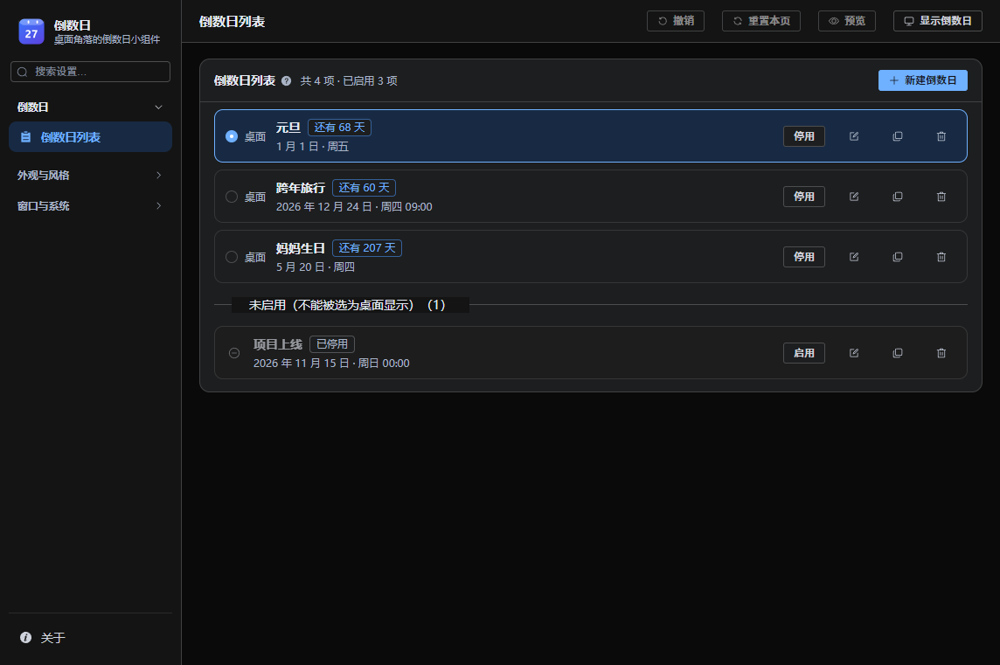
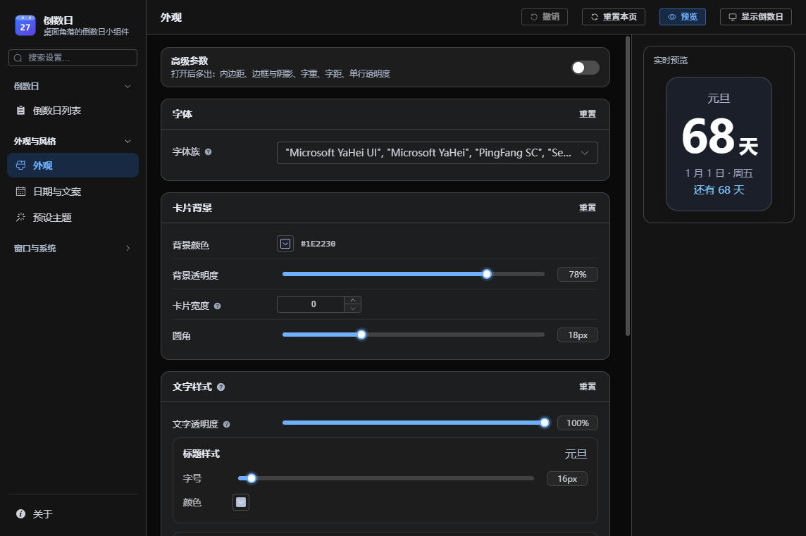
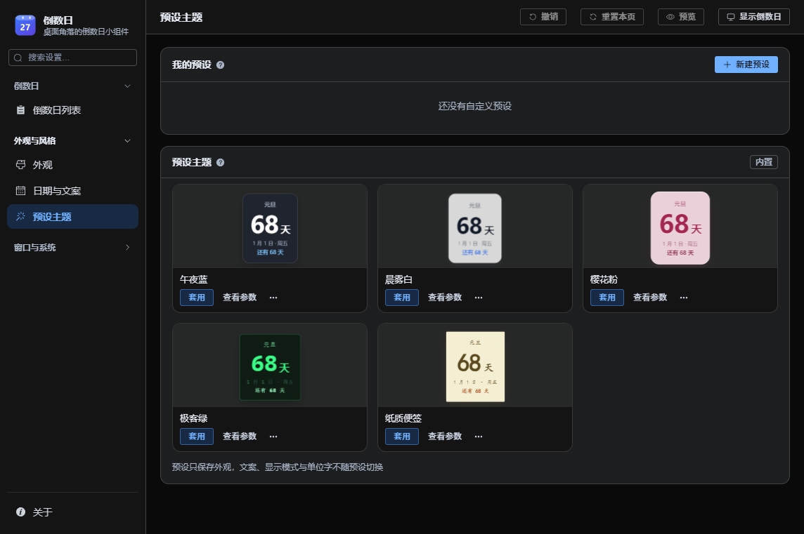

# 倒数日 CountingDown

Windows 桌面角落的倒数日小组件。一张可调外观的透明卡片，常驻托盘，设置界面是一个完整的图形界面。


## 能做什么

| 能力 | 说明 |
| --- | --- |
| **多项倒数日** | 想放多少放多少，选其中一项显示在桌面；支持每年重复的纪念日和一次性日期 / 时刻 |
| **单项独立** | 每项可以单独覆盖外观、文案、显示格式、单位字；没改的继续跟随全局 |
| **外观可调** | 背景、透明度、圆角、边框、阴影，以及四段文字各自的字号、颜色、字重、字距、字体 |
| **预设主题** | 午夜蓝 / 晨雾白 / 樱花粉 / 极客绿 / 纸质便签，一键换肤，也能存自己的 |
| **任意位置** | 四角任选，按住卡片就能拖，松手吸附到最近的角；可开鼠标穿透 |
| **托盘与快捷键** | 托盘左键显隐、右键菜单、双击开设置；默认 `ScrollLock` 开关卡片 |
| **在线更新** | 检查新版本、下载、校验、重启安装；更新源可在「关于」里切换 |

## 下载

到 [Releases](https://github.com/12yierye/CountingDown/releases/latest) 下载 `CountingDown Setup`。

Windows 10/11，安装到当前用户目录，不弹 UAC。安装包没有代码签名，首次运行会提示「未知发布者」，这是预期行为。

## 上手

**1. 卡片出现在桌面右上角**，托盘里多一个图标。托盘左键或 ***`ScrollLock`*** 显隐，托盘右键出菜单。

**2. 加一项倒数日**：设置首屏就是列表，点「新建倒数日」。每行左侧的单选决定哪一项显示在桌面。



**3. 调外观**：「外观」页右边有实时预览，改哪看哪；懒得逐项调就套预设主题。





> 编辑子页里的改动是**草稿**，点「保存」才生效、才写盘。

## 开发

```bash
pnpm install
pnpm dev            # 开发模式（渲染层热更新）
pnpm typecheck      # 主进程 + 渲染层类型检查
pnpm dist           # 构建 + 打包安装器（自写安装器，非 NSIS）
pnpm dist:nsis      # 退回 NSIS 的备用打包路径
```

需要 Node 18+ 与 pnpm。

## 文档

| 文档 | 内容 |
| --- | --- |
| [docs/FAQ.md](docs/FAQ.md) | 卡片不见、改了没生效、更新失败、开发环境的坑 |
| [NOTES.md](NOTES.md) | 实现细节、设计取舍、踩过的坑（按主题分册） |
| [docs/release-checklist.md](docs/release-checklist.md) | 发版流程，六步 |
| [docs/release-notes/](docs/release-notes/) | 每个版本的更新说明 |

配置文件在 `%APPDATA%\countingdown\config.json`，字段说明见 [notes/config.md](docs/notes/config.md)。
